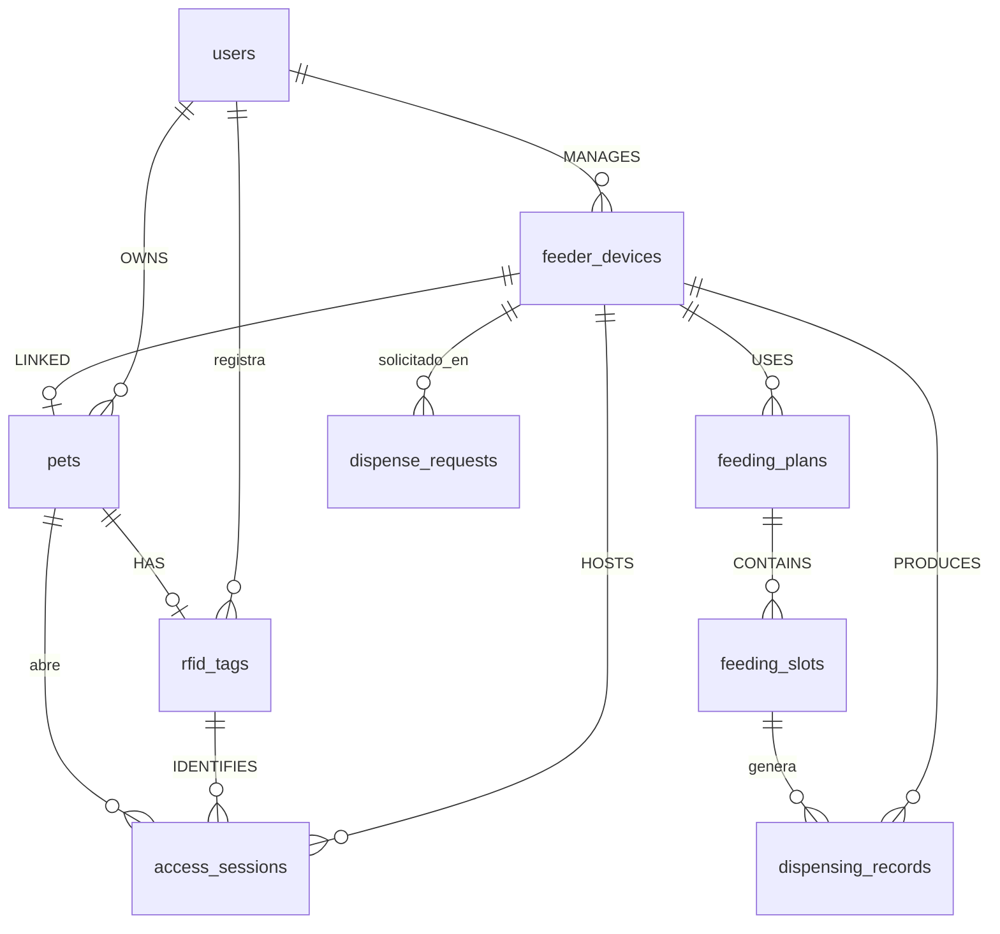

# Relaciones de la base de datos (TypeORM)

Fuente de verdad: `clases.txt` §5 *RELACIONES DEL DIAGRAMA* (apartado A). Este
documento describe cómo quedó materializado el modelo relacional en
`src/database/`, qué atributos cambiaron y cómo migrar datos existentes.

## Diagrama entidad-relación



Cardinalidades según el diagrama y cómo quedaron en la BD:

| Relación | Tipo | Lado dueño (FK) | Comportamiento |
|----------|------|-----------------|----------------|
| User → Pet | 1‑* | `pets.ownerId` → `users.id` | RESTRICT (por defecto) |
| User → FeederDevice | 1‑* | `feeder_devices.ownerId` → `users.id` | RESTRICT |
| User → RfidTag | 1‑* (no estaba en el diagrama; `ownerId` ya existía) | `rfid_tags.ownerId` → `users.id` | RESTRICT |
| Pet ↔ RfidTag | 1‑0..1 | `rfid_tags.petId` → `pets.id` + **UNIQUE** | `ON DELETE SET NULL` |
| Pet ↔ FeederDevice | **1‑1** (regla de negocio) | `feeder_devices.petId` → `pets.id` + **UNIQUE** | `ON DELETE SET NULL` |
| FeederDevice → FeedingPlan | 1‑* | `feeding_plans.deviceId` → `feeder_devices.id` | RESTRICT |
| FeedingPlan → FeedingSlot | 1‑* | `feeding_slots.planId` → `feeding_plans.id` | `ON DELETE CASCADE` |
| FeederDevice → AccessSession | 1‑* | `access_sessions.deviceId` | RESTRICT |
| FeederDevice → DispensingRecord | 1‑* | `dispensing_records.deviceId` | RESTRICT |
| FeedingSlot → DispensingRecord | 1‑* | `dispensing_records.slotId` → `feeding_slots.id` | `ON DELETE SET NULL` (el registro conserva sus datos) |
| RfidTag → AccessSession | 1‑* | `access_sessions.tagUid` → `rfid_tags.uid` | RESTRICT |
| Pet → AccessSession | 1‑* (la sesión congela la mascota que abrió) | `access_sessions.petId` | RESTRICT |
| FeederDevice → DispenseRequest | 1‑* | `dispense_requests.deviceId` | RESTRICT |

Restricciones únicas: `users.email`, `rfid_tags.petId` (garantiza "como máximo
un tag por mascota" en la relación 1‑0..1) y `feeder_devices.petId` (garantiza el
1‑1 mascota↔comedero en **ambos** sentidos).

> **Nota sobre Pet ↔ FeederDevice (regla de negocio):** la relación es 1‑1: un
> comedero sirve a **una sola mascota** y una mascota come en **un solo
> comedero** (dos mascotas = dos comederos). La columna UNIQUE lo impide en la
> BD; `DeviceService.grantAccess` además responde `409` si el comedero ya está
> ligado a otra mascota o si la mascota ya está ligada a otro comedero, para no
> dejar el error llegar como 500. Autorizar dos veces a la misma mascota sigue
> siendo idempotente. El vínculo se serializa igual que antes como
> `authorizedPetIds: []` con 0 o 1 elementos, así que el contrato con el
> firmware (`ConfigurationData.authorizedPetIds`) no cambia.

> **Nota sobre FeederDevice → FeedingPlan:** en la BD la cardinalidad es 1‑* (FK
> simple en `feeding_plans.deviceId`, sin restricción única), como pide el
> diagrama. El servicio (`FeedingService.createPlan`) sigue respondiendo `409` si
> ya existe un plan para el comedero: el límite vive en la capa de aplicación, no
> en el esquema.

### Relaciones del diagrama sin tabla propia

- `Pet 1 ── ACCUMULATES ── 0..* DailyConsumption`: es un **cálculo** (suma de
  `dispensing_records` por `accountingDay`), no una entidad persistida.
- `FeederDevice 1 ── SCOPES ── 0..* DailyAccessControl`: ídem, se deriva de
  `access_sessions` agrupadas por día.

No se crearon tablas para ellas a propósito: agregarlas duplicaría datos que ya
están en `dispensing_records` / `access_sessions`.

## Convención de anotaciones (importante)

Toda relación entre entidades se declara con **target por string** y las
anotaciones se importan con `import type`:

```ts
import { Column, Entity, JoinColumn, ManyToOne, PrimaryColumn } from 'typeorm';
import type { FeederDeviceOrmEntity } from '@/database/feeder-device.entity.js';

@ManyToOne('FeederDeviceOrmEntity', (device: FeederDeviceOrmEntity) => device.accessSessions)
@JoinColumn({ name: 'deviceId' })
device: FeederDeviceOrmEntity;
```

**Por qué:** el paquete es ESM (`"type": "module"`) con `emitDecoratorMetadata`.
Si dos entidades se importan entre sí como *valores*, el grafo de módulos se
cicla y el decorador ejecuta el callback de relación antes de que la clase esté
inicializada: `ReferenceError: Cannot access 'FeederDeviceOrmEntity' before
initialization` al arrancar (reproducido en `dist/`). Con `import type` (que
TypeScript borra en el emit) el único valor que viaja es el *string* con el
nombre de la clase, que TypeORM resuelve en tiempo de arranque sin ciclos.

Regla al añadir entidades: **nunca importar otra entidad de `src/database/` como
valor**; solo `import type` + string en el decorador. Los imports de valor se
reservan para TypeORM (`Column`, `ManyToOne`, …) y para modelos/valores del
dominio.

## Lado dueño de la FK

- La columna escalar que ya existía **se conserva junto a la relación**
  (`ownerId`, `deviceId`, `petId`, `planId`, `slotId`, `tagUid`): es la FK. El
  lado dueño lleva `@ManyToOne`/`@OneToOne` + `@JoinColumn({ name: … })` sobre
  esa misma columna (no se crea una columna nueva).
- El lado inverso (`@OneToMany`/`@OneToOne` sin `@JoinColumn`) solo se declara
  para las relaciones nombradas en el diagrama (p. ej. `PetOrmEntity.tag`,
  `FeederDeviceOrmEntity.plans`…). La ligación mascota↔comedero **solo** se
  declara del lado del comedero (`FeederDeviceOrmEntity.pet`): es el dueño de la
  FK y `DeviceRepository` así sigue escribiendo únicamente su propia tabla.
- Excepción: `feeder_devices.petId` es la única columna FK **nueva** (la
  ligación1‑1 no tenía columna: antes era el `jsonb authorizedPetIds`). Las
  demás reutilizan la FK que ya existía. No existen `pets.feederId` ni
  `feeder_devices.userId` (ni ninguna otra columna redundante).

## Atributos que cambiaron

| Antes | Ahora | Motivo |
|-------|-------|--------|
| `feeder_devices.authorizedPetIds` (`jsonb` de UUIDs) | columna **`feeder_devices.petId`** (FK 1‑1 con `UNIQUE`) | integridad referencial + regla de negocio "un comedero = una mascota": el `jsonb` no validaba que la mascota existiera, admitía varias y no impedía que la misma mascota estuviera en varios comederos |
| `feeding_plans.slots` (`jsonb` de `FeedingSlotConfiguration`) | tabla **`feeding_slots`** (relación 1‑* `slots`, orden por `position`) | el diagrama define `FeedingPlan 1 ── CONTAINS ── 0..* FeedingSlot` como entidad |

Se conservan a propósito (no son relaciones, son *snapshots* que escribe
`DeviceRepository` según `clases.txt`):

- `feeder_devices.desiredConfiguration` y `feeder_devices.appliedConfiguration`
  (`jsonb`): configuración enviada/aceptada por el dispositivo con su revisión.
  El payload puede contener horarios, pero eso no sustituye a la tabla
  `feeding_slots` (que es lo que alimenta la planificación y el historial).

El modelo de dominio no cambió: `FeederDevice.authorizedPetIds` sigue siendo un
`Set<Id>` (ahora con **0 o 1** elementos) y `FeedingPlan.slots` sigue siendo
`FeedingSlot[]`; solo cambió cómo se persisten. `DeviceRepository` ya no tiene
`saveAuthorizedPets`: `saveDevice` escribe `petId` directamente.

### Esquema generado (referencia)

```sql
-- feeder_devices: la ligación 1-1 vive en una columna propia
ALTER TABLE public.feeder_devices ADD COLUMN petId uuid;   -- nullable: puede no tener mascota aún
-- UNIQUE ("petId")  +  FK "petId" → pets(id) ON DELETE SET NULL
-- (el UNIQUE garantiza ambos sentidos: ni dos comederos con la misma mascota
--  ni una mascota en dos comederos)

CREATE TABLE public.feeding_slots (
    id uuid NOT NULL,
    "planId" uuid NOT NULL,
    "time" character varying NOT NULL,
    days text NOT NULL,              -- simple-array: "MONDAY,TUESDAY"
    "targetGrams" double precision NOT NULL,
    enabled boolean DEFAULT true NOT NULL,
    "position" integer NOT NULL      -- orden estable dentro del plan
);
-- PK (id); FK "planId" → feeding_plans(id) ON DELETE CASCADE
```

## Migración de datos existentes (Supabase, entorno con datos)

`synchronize: true` **elimina** las columnas `authorizedPetIds` y `slots` al
arrancar con el código nuevo, así que copiar los datos debe hacerse **antes** de
ese arranque. SQL editor de Supabase:

**1. Crear la columna nueva y la tabla `feeding_slots`** (sin restricciones: las
agrega `synchronize` al arrancar, sobre datos ya limpios):

```sql
ALTER TABLE public.feeder_devices ADD COLUMN IF NOT EXISTS "petId" uuid;

CREATE TABLE public.feeding_slots (
    id uuid NOT NULL,
    "planId" uuid NOT NULL,
    "time" character varying NOT NULL,
    days text NOT NULL,
    "targetGrams" double precision NOT NULL,
    enabled boolean DEFAULT true NOT NULL,
    "position" integer NOT NULL,
    CONSTRAINT "PK_e9bee39fc671380f260bf5cc270" PRIMARY KEY (id)
);
ALTER TABLE ONLY public.feeding_slots
    ADD CONSTRAINT "FK_b46142e34d3a2864d8828764abb"
    FOREIGN KEY ("planId") REFERENCES public.feeding_plans(id)
    ON DELETE CASCADE;
```

**2. Copiar los datos.** Regla 1‑1 aplicada a lo que había en el `jsonb`: por
cada comedero queda **su primera mascota**; si la misma mascota aparecía en
varios comederos, gana el primero. Se descartan mascotas que ya no existan:

```sql
-- feeder_devices.authorizedPetIds (jsonb) -> feeder_devices."petId"
WITH ranked AS (
  SELECT d.id AS device_id,
         pet.id AS pet_id,
         row_number() OVER (PARTITION BY d.id ORDER BY x.ord, d.id) AS por_comedero,
         row_number() OVER (PARTITION BY pet.id ORDER BY x.ord, d.id) AS por_mascota
  FROM feeder_devices d
  CROSS JOIN LATERAL jsonb_array_elements_text(d."authorizedPetIds")
    WITH ORDINALITY AS x(pet_id, ord)
  JOIN pets pet ON pet.id::text = x.pet_id
  WHERE d."authorizedPetIds" IS NOT NULL
    AND jsonb_typeof(d."authorizedPetIds") = 'array'
)
UPDATE feeder_devices d
SET "petId" = r.pet_id
FROM ranked r
WHERE d.id = r.device_id AND r.por_comedero = 1 AND r.por_mascota = 1;

-- feeding_plans.slots (jsonb) -> feeding_slots
INSERT INTO feeding_slots (id, "planId", time, days, targetGrams, enabled, position)
SELECT (s.elem->>'id')::uuid,
       p.id,
       s.elem->>'time',
       (SELECT string_agg(v, ',') FROM jsonb_array_elements_text(s.elem->'days') AS d(v)),
       (s.elem->>'targetGrams')::double precision,
       COALESCE((s.elem->>'enabled')::boolean, true),
       (s.ord - 1)::int
FROM feeding_plans p
CROSS JOIN LATERAL jsonb_array_elements(p.slots) WITH ORDINALITY AS s(elem, ord)
WHERE p.slots IS NOT NULL
  AND jsonb_typeof(p.slots) = 'array'
  AND (s.elem->>'id') IS NOT NULL
  AND (s.elem->>'time') IS NOT NULL
  AND (s.elem->>'targetGrams') IS NOT NULL
ON CONFLICT (id) DO NOTHING;
```

**3. Verificar** (la consulta de duplicados debe dar `0`: dos comederos no
pueden compartir mascota):

```sql
SELECT count(*) FROM feeder_devices WHERE "petId" IS NOT NULL;          -- comederos ligados
SELECT count(*) FROM (SELECT "petId" FROM feeder_devices
                      WHERE "petId" IS NOT NULL GROUP BY "petId" HAVING count(*) > 1) dup;  -- debe ser 0
SELECT count(*) FROM feeding_slots;
```

**4. Arrancar el código nuevo.** `synchronize` agrega `UNIQUE ("petId")` y la FK
`petId → pets(id) ON DELETE SET NULL`, crea `feeding_slots` (si no existía) y
borra `feeder_devices.authorizedPetIds` y `feeding_plans.slots`. Si el UNIQUE o
la FK no aparecieran (no debería pasar), se crean a mano:

```sql
ALTER TABLE public.feeder_devices ADD CONSTRAINT "feeder_devices_petId_key" UNIQUE ("petId");
ALTER TABLE public.feeder_devices ADD CONSTRAINT "feeder_devices_petId_fkey"
  FOREIGN KEY ("petId") REFERENCES public.pets(id) ON DELETE SET NULL;
```

En un entorno sin datos previos no hace falta ningún paso: `synchronize` crea el
esquema completo. Si en algún entorno llegó a existir la tabla `device_pets`
(entornos de prueba; **Supabase nunca la tuvo**), `synchronize` la elimina
automáticamente al detectar que ninguna entidad la declara.

## Verificación

Hecha contra Postgres efímero (imagen `postgres:16-alpine`) con el esquema
recién sincronizado:

- **Esquema:** `feeder_devices."petId"` con `UNIQUE` + FK a `pets(id)` y
  `ON DELETE SET NULL`; no existe `device_pets`; `feeding_slots` con su FK
  `CASCADE`. Inventario completo: **13 FK + 3 UNIQUE** (`users.email`,
  `rfid_tags.petId`, `feeder_devices.petId`).
- **Regla 1‑1:** autorizar mascota OK → re-autorizar idempotente → `409` al
  autorizar una segunda mascota al mismo comedero → `409` al poner la misma
  mascota en otro comedero → `UPDATE` directo que la salte viola el UNIQUE → al
  revocar, el comedero queda libre.
- **409 del plan:** `FeedingService.createPlan` devuelve `409` con el segundo
  plan aunque la BD admite dos filas (no hay `UNIQUE("deviceId")`).
- **Suite:** `npm run test:db` (15 escenarios) y `npm test` (20) en verde;
  `npm run lint` sin avisos.

> Nota: no hay endpoints que borren mascotas, tags o comederos; si se agregan,
> habrá que decidir el `ON DELETE` de las FK con comportamiento RESTRICT
> (`access_sessions`, `dispensing_records`, `dispense_requests`). Al borrar una
> mascota, `feeder_devices.petId` queda en `NULL` (el comedero queda libre) y lo
> mismo aplica al tag (`rfid_tags.petId`).
